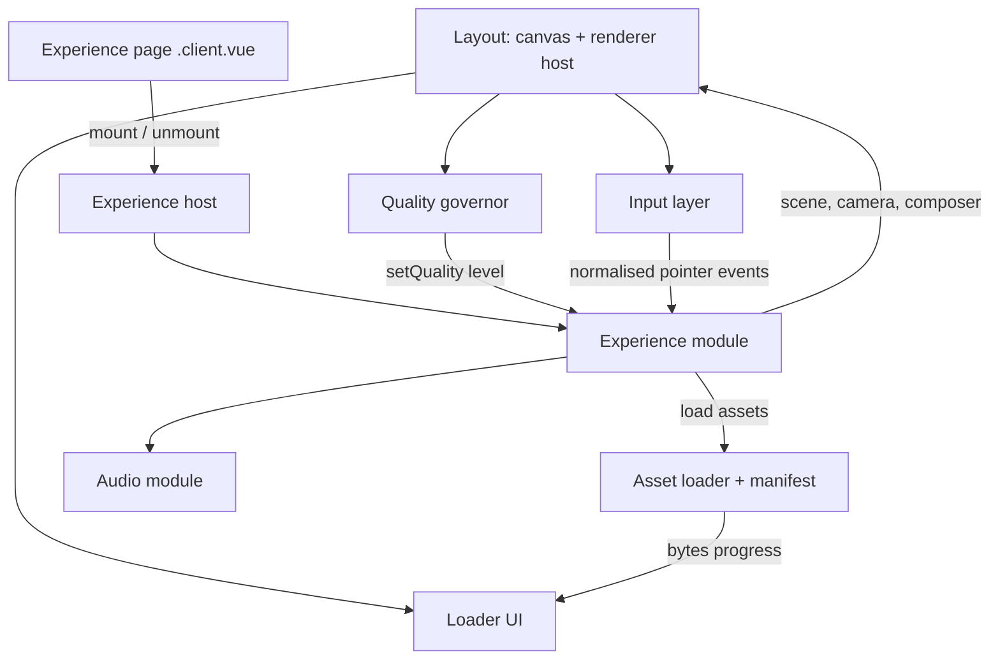
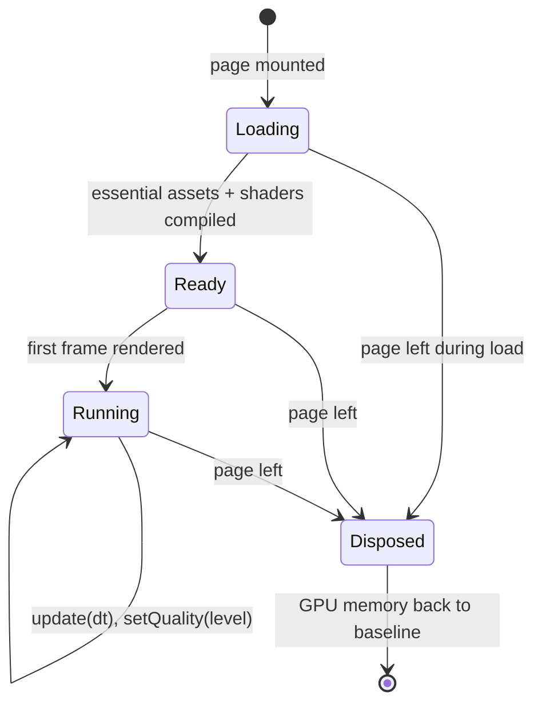

# Nuxt 4 Migration with Mobile-Ready Experiences - Plan

## Goal Capsule

- **Objective:** Every page and experience of www.remydumas.fr opens and runs smoothly on a recent iPhone and a mid-range Android, and loads faster on every device, with the same look, texts and interactions as today.
- **Means:** Migrate the site to Nuxt 4 and a current stack, with every experience mounted on one shared WebGL renderer behind one experience contract, and ship as a single cut-over once every page is ported (KTD1, KTD2, KTD3).
- **Product authority:** Rémy (site owner). The Product Contract below wins on behavior; Key Technical Decisions win on mechanism within it.
- **Execution profile:** Long-running, unit by unit on branch `feat-nuxt4-mobile-xp` of `ntn-boilerplate`; the current site stays live on `master` until U14.
- **Stop conditions:** Stop and ask the owner if a scene cannot reach its Success Criteria at its quality floor, if a perceived result has to change beyond what R8 allows, or if a Vercel or domain setting outside the `ntn-boilerplate` project would need to change.
- **Who finishes:** The implementer lands U1–U13 on the branch; U14's on-device pass and the cut-over merge need the owner's confirmation.
- **Open blockers:** None for U1–U13. U14's Android pass needs a mid-range Android device or a named remote device service, which the owner has not confirmed yet.

---

## Product Contract

Product Contract preservation: changed: R20 added on 2026-10-26, then redefined the same day after the owner's parity review — `discomania` keeps the live site's kick timing.

### Summary

The site is rebuilt on Nuxt 4 with three.js r186 and GSAP 3, keeping its design, texts and URLs. Each experience is re-audited and rebuilt with the most efficient rendering technique that preserves its perceived result, runs behind a shared contract (start, teardown, adaptive quality, real loading progress, touch input), and works on mobile. Navigation becomes client-side, and the domain switches to the new build only when every page passes on the reference devices.

### Problem Frame

The live site (Nuxt 2, three.js r127, GSAP 2, last deployed February 2024) was built for desktop.
`illuminate` and `field` refuse to run on mobile and show "This project is only available on computer" (`pages/illuminate/index.vue:20-21`, `pages/field/index.vue:41`).
`discomania`, `flower`, `attract` and `photography` start on mobile without any adaptation: `attract` reacts to mouse events only (`assets/scripts/attract/script.js:30-33`), and the five travel pages scroll through a `wheel` handler only.
Touch scroll on iOS was broken until commit `fa54148` (2026-10-26).

Rendering costs are high for phones: forward-rendered point lights (up to 60 in `illuminate`, 70 in `discomania`), about 4.1M grass triangles plus bloom at full device pixel ratio in `field`, antialiasing everywhere.
Loading is opaque: the loader never reflects asset progress (`store/index.js`, `components/Loader.vue`), and the two audio experiences depend on full mp3 files of 6.96 MB and 7.52 MB.
Nothing is torn down when leaving a page; that only works today because every link is a full page reload.
Nuxt 2 has been end-of-life since June 2024, and the Vercel build needed Node and OpenSSL workarounds to deploy at all.

### Key Decisions

- **Migrate to Nuxt 4 with a current stack (three.js r186, GSAP 3).** (session-settled: user-directed — chosen over keeping Nuxt 2 or upgrading three.js only: the site should leave an end-of-life stack in the same effort.) Governs R1.
- **Nuxt 4 rather than Nuxt 3.** (session-settled: user-approved — chosen over Nuxt 3: Nuxt 3 is in maintenance only, same migration effort.) Governs R1.
- **Same perceived result, not same code.** (session-settled: user-directed — chosen over a straight port of the existing rendering logic: each experience's performance and rendering logic must be questioned and improved.) Governs R7, R8, R9.
- **Adaptive quality instead of a fixed mobile version.** (session-settled: user-directed — chosen over a fixed lighter mobile build or a desktop-identical one: detail follows measured performance on every device.) Governs R10, R11.
- **Client-side navigation.** (session-settled: user-directed — chosen over keeping full page reloads, with the cost of mandatory teardown shown: faster transitions between pages.) Governs R4, R5.
- **Real loading progress and fast start.** (session-settled: user-approved — chosen over a shortened version of the current loader or no loader at all.) Governs R12, R13, R14.
- **Like-for-like design and content.** (session-settled: user-approved — chosen over updating the bio texts or allowing a redesign: those are separate projects.) Governs R2, R3.
- **Single cut-over with a shared experience contract.** (session-settled: user-approved — chosen over a page-by-page strangler migration on the live domain and over porting each experience without a shared contract: one codebase at the end, and teardown, quality and progress are solved once for all experiences.) Governs R6, R19.
- **Touch mapping is decided per experience.** (session-settled: user-directed — chosen over a single rule such as finger-drag everywhere or gyroscope.) Governs R15, R16.
- **`discomania` keeps the live site's kick detector.** (session-settled: user-directed — chosen over reacting to real low-frequency kicks: a real-kick detector changed the opening 30 s, which are white and calm on the live site, and identical rendering wins.) Governs R20.

### Requirements

**Platform and parity**

- R1. The site runs on Nuxt 4 with three.js r186 and GSAP 3, built and deployed by Vercel without legacy runtime flags.
- R2. Every page keeps its current visual design, texts, images and audio tracks.
- R3. Every current URL (`/`, `/attract`, `/discomania`, `/field`, `/flower`, `/illuminate`, `/photography`, `/croatia`, `/netherlands`, `/sweden`, `/north_thailand`, `/south_thailand`) keeps resolving to the same page.

**Navigation and lifecycle**

- R4. Moving between pages happens without a full page reload.
- R5. Leaving a page releases everything its experience allocated — GPU resources, render loop, audio, event listeners — so that browsing every page in sequence on the reference iPhone causes neither a crash, a reload by the browser, nor growing memory.
- R6. Every experience implements one shared contract: start, teardown, quality level, loading progress and input handling.

**Rendering logic (per-experience audit)**

- R7. Each experience (`attract`, `discomania`, `field`, `flower`, `illuminate`, `photography`, home page) is audited, and its rendering and performance logic is rebuilt with the most efficient current technique that reproduces its perceived result.
- R8. When the new technique allows more (more lights, particles, instances or density) at equal or better frame rate, the experience may use it, as long as its intent and look stay recognizably the same.
- R9. `illuminate` supports a much larger number of lights than today's cap of 60, without the per-light cost of the current forward-rendered point lights.
- R20. `discomania`'s colour flashes and cage blinks fire exactly when the live site's detector fires (loudest of the 18–22 kHz bins against a decaying threshold): calm and white for the first ~30 s, then strobing.

**Adaptive quality**

- R10. Each experience adjusts its level of detail at runtime from measured frame rate, on mobile and desktop alike.
- R11. Each experience defines a quality floor below which it does not degrade further; that floor still delivers the experience's core effect and interaction.

**Loading**

- R12. The loader reflects real loading progress of the assets the current page needs.
- R13. An experience becomes visible and interactive as soon as its essential assets are ready; secondary assets keep loading in the background.
- R14. `discomania` and `flower` start playing audio without first downloading the whole track, while their audio-reactive visuals keep working.

**Mobile input**

- R15. No page shows the "only available on computer" notice; every experience runs on mobile.
- R16. Mouse-driven interactions get a touch equivalent per experience: `field` follows a dragging finger; `illuminate` adds lights on tap and moves on drag; `attract` attracts on drag; `discomania` and `flower` start on tap of their play button; `photography` keeps its swipe; the travel pages scroll natively.
- R17. Touch versus mouse behavior is chosen from the input actually used, not from the user-agent, so tablets and touch laptops get the right interaction.
- R18. Desktop interactions (wheel, mouse move, hover, custom pointer) keep working as today.

**Delivery**

- R19. The domain switches to the new build only once every page meets the Success Criteria; until then the current site stays live.

### Acceptance Examples

- AE1. **Covers R5.** Given the reference iPhone, when a visitor opens every experience one after the other through in-site links and comes back to the home page, then no tab reload or crash occurs and memory returns near its starting level.
- AE2. **Covers R10, R11.** Given `field` running on the mid-range Android at below 30 fps, when quality adapts, then detail drops step by step until frame rate recovers, and never below the floor where the grass and its reaction to the finger are still visible.
- AE3. **Covers R14.** Given `flower` on a mobile connection, when the visitor taps play, then sound starts within a few seconds instead of after a 7.5 MB download, and the sphere reacts to the music.
- AE4. **Covers R17.** Given an iPad (which reports itself as a Mac), when the visitor touches `attract`, then the touch interaction applies, not the desktop one.
- AE5. **Covers R9.** Given `illuminate` on desktop, when the visitor keeps clicking past 60 lights, then lights keep appearing with no visible frame-rate collapse.
- AE6. **Covers R20.** Given `discomania` playing the first ~30 s of the track, when the 18–22 kHz band stays below the legacy threshold, then the bulbs stay white and no cage blinks, as on the live site.

### Success Criteria

- On a recent iPhone, every experience runs at about 60 fps; on a mid-range Android (Pixel 6a / Galaxy A5x class), at 30 fps or more, with no crash or black screen.
- Desktop frame rate and visual quality are equal to or better than the current site.
- Each experience's first interactive frame arrives noticeably sooner than on the current site, measured on the same connection.

### Scope Boundaries

- Redesign, new copy, and updates to the bio or experiences list.
- Gyroscope or device-motion input.
- New experiences or new pages.
- Updating the original `portfolio` repository, which is not deployed anywhere.
- Considered and not built: a WebGPU renderer path. three.js r186 still labels it experimental, it rules out the existing GLSL shaders and `EffectComposer`, and its many-lights addon has no WebGL2 fallback before r187. Revisit when r187 ships the `ClusteredLighting` WebGL2 fallback and a scene needs more lights than KTD5 delivers.
- Considered and not built: prefetching other pages' essential assets while idle. No requirement asks for it and it spends mobile data on pages the visitor may never open; revisit if in-site navigation measures slow.
- Considered and not built: pixel-diff visual regression tests. Light and colour models changed between r127 and r186 (KTD9), so pixel diffs against the old site would fail by construction; parity is judged side by side by eye in U14.

### Dependencies / Assumptions

- The reference devices are the owner's recent iPhone and one mid-range Android; Android validation assumes access to such a device or a remote device service.
- Audio files may be re-encoded or segmented as long as the tracks stay the same (R2).
- The Vercel project `ntn-boilerplate` serving www.remydumas.fr can switch to the new build's settings at cut-over.

### Outstanding Questions

**Deferred to Implementation**

- Exact light counts per quality level in `illuminate` and `discomania`, measured on the reference devices (KTD5).
- Final blade segment count and bloom resolution in `field` that keep the look at each quality level (U9).
- Whether the iOS 26 analyser returns real data for a streamed `<audio>` source; if it returns zeros, U7 falls back to fetch-and-decode for that browser (KTD7).

### Sources / Research

- Grounding dossier of the current site and a per-experience rendering audit, verified against the code on 2026-10-26 (cost drivers quoted in Planning Contract below).
- `layouts/default.vue` — user-agent detection and the iOS scroll fix (`fa54148`).
- `assets/scripts/{attract,black,field,flower,illuminate}/script.js`, `pages/photography/index.vue`, `pages/index.vue` — current rendering logic.
- npm registry on 2026-10-26: nuxt 4.6.2, three 0.186.1, gsap 3.15.0, @nuxt/image 2.2.0, cannon-es 0.20.0.

---

## Planning Contract

### Key Technical Decisions

- KTD1. **One persistent `WebGLRenderer` and canvas for the whole app.** It lives in the layout, outside `<NuxtPage>`; experiences attach to it and detach from it. iOS Safari leaks GPU memory and can kill the tab when WebGL contexts are created per page (WebKit bugs 290623, 300782), so reuse beats recreation. The context is created with `antialias: true`, as the legacy renderers were: switching it off made every edge visibly jagged against the live site, while MSAA is cheap on tile-based mobile GPUs; pixel ratio stays the governor's first knob. The host snapshots renderer-level state before each mount and restores it after dispose. Implements R4, R5.
- KTD2. **Stay on `WebGLRenderer` with GLSL and `EffectComposer`; no `WebGPURenderer`.** The three.js r186 manual calls `WebGPURenderer` experimental and recommends `WebGLRenderer` for WebGL2 apps; moving would force a TSL rewrite of every custom shader for no parity gain. Implements R1, R7. See Scope Boundaries for the revisit condition.
- KTD3. **Framework-agnostic experience modules behind one contract.** Each experience is a plain TypeScript module under `app/experiences/<name>/` exposing load, mount, update, setQuality, resize, input and dispose; Vue pages only mount and unmount them. Teardown, quality and progress are implemented once in `app/experiences/core/`. The home page has no experience module: its dead WebGL code is removed (U2), so R6 applies to the six experiences of U8–U13. (session-settled: user-approved — chosen over porting each experience without a shared contract: the same lifecycle would otherwise be re-implemented six times.) Implements R6.
- KTD4. **Static generation with SSR on (`nuxt generate`), WebGL in client-only components.** Pages prerender their HTML for first paint and SEO; experience hosts are `.client.vue` components. Do not use `nitro.preset: 'bun'`; Bun is the package manager and script runner, Nuxt's CLI runs on Node 24. Implements R1, R3.
- KTD5. **Many lights through a fixed-size light loop in the shader, plus glow sprites.** Light positions, colours and radii live in a data texture read by an `onBeforeCompile` hook on the scene materials; the light count is a uniform, so adding lights never recompiles shaders. Each light has a finite radius with a windowed falloff, and fragments skip lights outside it. The maximum shaded count is set per quality level (starting points 256 / 96 / 48, tuned in U8); lights beyond it keep an additive glow sprite. (session-settled: user-approved — chosen over three.js `ClusteredLighting`, which needs WebGPU in r186.) Implements R9, used by U8 and U10.
- KTD6. **Quality governor on median frame time with hysteresis.** It is modelled on drei's `PerformanceMonitor`: rolling windows, a warm-up after mount, fast degrade and slow upgrade, and a flip-flop limit. No web API exposes the display refresh rate, and a GPU missing a 60 Hz budget also presents at ~33 ms, so steady ~33 ms frames trigger a one-step probe: if frames speed up after one degrade, the GPU was the limit and governing continues; if they stay at ~33 ms, it is a refresh cap (iOS Low Power Mode), the previous level is restored and degrading stops for the session. Knob order is pixel ratio, then post-processing resolution and antialiasing, then post-processing off, then scene-specific counts. Every experience starts at its middle level with a capped device pixel ratio (2 on iOS, 1.5 elsewhere). Implements R10, R11.
- KTD7. **Audio streams from an `<audio>` element routed into an `AnalyserNode`, fed to the GPU as a data texture.** Tracks are re-encoded to AAC (`.m4a`) and served same-origin from `public/`. The `AudioContext` resumes and playback starts inside the tap handler, with `navigator.audioSession.type = 'playback'` where supported so the silent switch does not mute it. FFT size drops to 2048 or less; mesh detail no longer depends on it. If the analyser returns zeros for a streamed source on a browser, the fallback stays streamed: the track is also encoded as short AAC segments, decoded and scheduled back to back into the same analyser. Implements R14, R20.
- KTD8. **Real progress from a build-time asset manifest.** A generated manifest lists each asset's byte size per route; the loader streams each fetch and counts bytes for the first 90% of the bar, and shader compile and decode steps fill the last 10%. `Content-Length` is not trusted because compressed responses report the wrong size. Implements R12, R13.
- KTD9. **Per-scene light and colour retuning against the old site.** Colour management (r152) and physically based light units (r155) cannot be switched off in r186, so every scene's intensities, decays and colours are re-tuned by eye, side by side with the live site. Implements R2.
- KTD10. **Pointer Events with `pointerType`, never the user-agent.** One input layer normalises pointer events per experience; full-screen scenes use `touch-action: none` with pointer capture, and canvases inside scrolling pages use `touch-action: pan-y`. The `is__mobile` / `is__desktop` classes are replaced by `(hover: hover) and (pointer: fine)` media queries for layout and by `pointerType` for behavior. Implements R16, R17, R18.
- KTD11. **`cannon-es` for physics, stepped with a fixed time step.** It is a drop-in, small, maintained-enough fork of `cannon`. The body count equals `illuminate`'s light cap per quality level (U8), up to about 400 spheres on desktop; Rapier (~1.66 MB gzipped) is the fallback only if U8 measures the cannon-es step over budget at that count. All animation moves to delta time, and physics uses a fixed-step accumulator local to `illuminate`, so speed no longer depends on frame rate (60, 120 Hz or the 30 Hz Low Power cap). Implements R7.
- KTD12. **GSAP 3 with `gsap.defaults({ overwrite: 'auto' })`, scoped per page with `gsap.context()`.** The default restores GSAP 2's overwrite behavior the current animations rely on; contexts are reverted on unmount. Implements R2, R5.
- KTD13. **Assets re-encoded at build-prep time, originals kept out of the bundle.** Photos become AVIF and WebP through `@nuxt/image` at generate time, with the provider pinned to `ipxStatic` so a Vercel build does not switch to Vercel's image service; the `attract` source image is downscaled from 8164 × 5102 to the largest size it is drawn at; the grass texture becomes power-of-two. Implements R13, R2.

### High-Level Technical Design

Component shape: the layout owns the renderer and the global services; pages own nothing but an experience handle.

Experience lifecycle, which the contract enforces and U3's tests exercise:

Target technique per experience (each row is owned by its unit; the cost drivers come from the rendering audit):

| Experience | Today's main cost | Target technique | Quality knobs (high → floor) |
|---|---|---|---|
| `illuminate` (U8) | up to 60 forward point lights over full-screen Phong, shader recompile per click, 60 separate bulb meshes, naive broadphase | KTD5 light loop, one instanced bulb mesh, glow sprites, `cannon-es` with SAP broadphase and fixed step | shaded lights 256 → 48, pixel ratio |
| `field` (U9) | ~4.1M grass triangles (2000 × 32×32 segments), full-DPR bloom, unused per-frame raycast over 2000 instances, unused render targets | blades with a handful of segments, wind and finger displacement in the vertex shader from one projected cursor point, bloom at reduced resolution | pixel ratio, bloom resolution, bloom off, visible blade count |
| `discomania` (U10) | 70 point lights in every fragment, 122 draw calls, two render loops, full decode of the track | KTD5 light loop, 50 cages as one instanced mesh, one loop, KTD7 streaming, real kick detection | pixel ratio, shaded lights |
| `flower` (U11) | 8192-bin FFT, CPU displacement loop and two buffer uploads per frame | KTD7 frequency texture sampled in the vertex shader, per-vertex bin index attribute keeping today's seam tearing | pixel ratio, sphere detail |
| `attract` (U12) | one 2D `fill()` per dot, 166 MB decoded source image | GPU points on the shared renderer, attraction in the vertex shader | pixel ratio, grid density |
| `photography` (U13) | full-DPR canvas, CPU geometry rewrite on every tween tick, 15 materials, idle re-render | plane transforms instead of geometry rewrites, shared material with per-plane uniforms, render on change only | pixel ratio |
| home and travel pages (U2) | perpetual empty render loop, nested tween bursts on wheel, eager full-size images | no render loop, one tween per wheel step, responsive lazy images, native scroll on touch | — |

### Assumptions

- Vercel serves `.m4a`, `.avif` and `.webp` from `public/` without compression, so byte counts match the manifest; U5 verifies this on the preview deployment.
- The owner's iPhone runs iOS 18 or later.

### Sequencing

U1 first. U3, U4, U5, U6 and U7 form the shared core and land before any experience. U2 can run in parallel with the core. U8–U13 depend on the core and are independent of each other. U14 closes the work.

---

## Implementation Units

| U-ID | Title | Files touched | Depends on |
|---|---|---|---|
| U1 | Nuxt 4 scaffold, build and deploy config | `nuxt.config.ts`, `package.json`, `app/app.vue`, `app/layouts/default.vue` | — |
| U2 | Home and travel pages port | `app/pages/index.vue`, `app/pages/{croatia,...}.vue`, `app/components/` | U1 |
| U3 | Shared renderer host and experience contract | `app/experiences/core/`, `tests/e2e/dispose.spec.ts` | U1 |
| U4 | Quality governor | `app/experiences/core/quality-governor.ts` | U3 |
| U5 | Asset manifest, loader and progress UI | `scripts/build-asset-manifest.ts`, `app/experiences/core/asset-loader.ts`, `app/components/SiteLoader.vue` | U3 |
| U6 | Input layer | `app/experiences/core/input.ts` | U3 |
| U7 | Audio module | `app/experiences/core/audio.ts` | U3, U5 |
| U8 | `illuminate` rebuild | `app/experiences/illuminate/` | U3–U6 |
| U9 | `field` rebuild | `app/experiences/field/` | U3–U6 |
| U10 | `discomania` rebuild | `app/experiences/discomania/` | U3–U7 |
| U11 | `flower` rebuild | `app/experiences/flower/` | U3–U7 |
| U12 | `attract` rebuild | `app/experiences/attract/` | U3–U6 |
| U13 | `photography` rebuild | `app/experiences/photography/` | U3–U6 |
| U14 | Device validation and cut-over | `tests/e2e/`, Vercel project settings | U2, U8–U13 |

### U1. Nuxt 4 scaffold, build and deploy config

**Goal:** Replace the Nuxt 2 app with an empty Nuxt 4 app that builds with Bun, generates statically, and deploys to a Vercel preview with every current URL answering.

**Requirements:** R1, R3, R4.

**Dependencies:** None.

**Files:**
- `package.json`, `bun.lock`, `nuxt.config.ts`, `tsconfig.json`, `vercel.json`
- `app/app.vue`, `app/layouts/default.vue`, `app/error.vue`
- `app/assets/styles/` (global styles and fonts moved from `layouts/default.vue`)
- `public/` (fonts, audio, images, typeface JSON moved from `static/`)
- Remove: `.nuxt/`-era files, `store/`, `middleware/`, `plugins/`, `components/Pointer.1.vue`, `netlify.toml`, `.htaccess`, `yarn.lock`
- `tests/routes.test.ts`

**Approach:**
1. Scaffold Nuxt 4 in place on the branch, with `app/` as the source directory and `ssr: true` (KTD4).
2. Move global styles, `@font-face` rules and theme handling out of the old layout into `app/assets/styles/`; theme becomes a composable instead of a Vuex mutation.
3. Register one page per current URL as a placeholder so routing and prerendering can be checked before any port.
4. Set `gsap.defaults({ overwrite: 'auto' })` in a client-only plugin (KTD12).
5. Replace every `<a href>` with `<NuxtLink>` (R4).
6. Scope the new build settings to the branch, not the Vercel dashboard: a `vercel.json` committed on the branch sets the build command (`bun run generate`) and output directory (`.output/public`), and `package.json` `engines.node` is `24.x`. Dashboard settings stay untouched until U14, so `master` keeps deploying the live site.
7. Pin `@nuxt/image` to the `ipxStatic` provider (KTD13).

**Patterns to follow:** current global styles in `layouts/default.vue`; route list in `pages/`.

**Test scenarios:**
- Happy path: generating the site produces one HTML file per URL listed in R3.
- Edge case: an unknown URL renders the error page rather than an empty shell.

**Verification:** `bun run generate` succeeds on Node 24; the Vercel preview answers every R3 URL; navigating between two placeholder pages causes no full reload; a deploy of `master` during the work still builds the live site.

### U2. Home and travel pages port

**Goal:** Port the home page and the five travel pages with their exact look, GSAP 3 animations, native touch scroll and lazy responsive images.

**Requirements:** R2, R3, R7 (home), R15, R16 (travel pages), R17, R18.

**Dependencies:** U1.

**Files:**
- `app/pages/index.vue`, `app/pages/croatia.vue`, `app/pages/netherlands.vue`, `app/pages/sweden.vue`, `app/pages/north_thailand.vue`, `app/pages/south_thailand.vue`
- `app/components/TravelGallery.vue` (shared by the five travel pages, which are near-identical today)
- `app/components/SplitLetters.vue`, `app/components/CustomPointer.vue`
- `app/composables/useWheelScroll.ts`
- `tests/wheel-scroll.test.ts`

**Approach:**
1. Rebuild the home intro (letter split and stagger) with GSAP 3 `stagger`; drop the dead WebGL code and the perpetual render loop.
2. Replace nested `staggerTo` + `onComplete` bursts with one timeline per wheel step that tweens position and skew, then relaxes the skew.
3. Wheel-driven scrolling runs only when the pointer is fine and hovering (KTD10); touch devices scroll natively.
4. Render photos with `<NuxtPicture>` (AVIF, WebP fallback, `loading="lazy"`, explicit sizes); the hidden-on-mobile profile image is not downloaded on narrow screens (KTD13).
5. The custom pointer component renders only for fine pointers.

**Patterns to follow:** `pages/index.vue` (intro timeline at :608-641, wheel at :667-708), `pages/croatia/index.vue` (wheel at :90-122, layout CSS at :160-220).

**Test scenarios:**
- Happy path: a wheel delta of one notch moves the scroll target by the same distance as today (`delta * 45`) and clamps at both ends.
- Edge case: a wheel event arriving while the previous tween runs retargets the running tween instead of stacking new ones.
- Integration: on a touch device emulation, the travel page scrolls natively and the wheel handler is not attached.

**Verification:** Side by side with the live site, the home intro and travel pages look and move the same on desktop; on the reference iPhone they scroll natively with images loading lazily; the generated AVIF and WebP files exist under `.output/public/_ipx/` and the preview serves them.

### U3. Shared renderer host and experience contract

**Goal:** Provide the one renderer, the experience contract and the lifecycle that guarantees full teardown on page leave.

**Requirements:** R4, R5, R6.

**Dependencies:** U1.

**Files:**
- `app/experiences/core/renderer-host.ts`
- `app/experiences/core/experience.ts` (contract types and lifecycle runner)
- `app/experiences/core/dispose.ts` (scene traversal disposal helpers)
- `app/experiences/core/clock.ts` (per-frame delta time)
- `app/components/ExperienceHost.client.vue`, `app/components/ExperienceFallback.vue`
- `tests/core/experience-lifecycle.test.ts` (pure lifecycle states with a stub experience)
- `tests/e2e/dispose.spec.ts` (GPU resource counts in a real browser; `bun test` has no WebGL2 context)

**Approach:**
1. The renderer host creates the `WebGLRenderer` once with `antialias: true` (KTD1), owns the single animation loop, resizes through `ResizeObserver` (iOS fires `resize` on URL-bar changes), and pauses when the tab is hidden.
2. The contract (KTD3) defines load, mount, update, setQuality, resize, input and dispose; the lifecycle runner enforces the states in the High-Level Technical Design and ignores late async results after dispose.
3. Before mount, the host snapshots renderer-level state (clear colour and alpha, tone mapping and exposure, output colour space, shadow map settings, `autoClear`, pixel ratio, viewport and scissor); after dispose it restores the snapshot and calls `renderer.resetState()`.
4. Disposal traverses the scene and releases geometries, materials, textures (including textures held in uniforms), render targets and composer passes, then checks `renderer.info.memory` against the baseline recorded before mount and logs a warning on mismatch in development.
5. `ExperienceHost.client.vue` mounts an experience on `onMounted` and disposes it on `onBeforeUnmount`. On page leave the canvas fades out with the page transition, so no frame of the old scene shows under the new page; while the next experience loads, the canvas stays cleared to that page's background colour and the loader appears per U5.
6. `ExperienceFallback.vue` covers load failure and `webglcontextlost`: the page's own title and text stay visible, a one-line message in the site's subtitle style says the experience could not start, and a link returns home. On `webglcontextrestored` the current experience is rebuilt.

**Execution note:** Write the lifecycle test and the browser dispose spec before the host; the dispose spec is the only automated guard for R5.

**Patterns to follow:** none in the repo — no script exposes a stop or dispose path today; follow the contract in the High-Level Technical Design.

**Test scenarios:**
- Happy path (browser): mounting a stub experience then disposing it leaves geometry, texture and program counts at their pre-mount values.
- Edge case: disposing while loading is still pending cancels the pending load, and its late result is discarded without mounting.
- Edge case (browser): a texture referenced only through a shader uniform is disposed.
- Edge case (browser): an experience that changes clear colour and tone mapping leaves the host's defaults intact after dispose.
- Error path: when a load step throws, the experience goes to Disposed and the page shows its fallback rather than a black canvas.
- Integration: navigating A → B → A through the host mounts B only after A is disposed, and only one animation loop runs at any time.

**Verification:** `bun test` and the browser specs pass; in the dev build, navigating across every experience 30 times leaves `renderer.info.memory` at baseline.

### U4. Quality governor

**Goal:** Measure frame time and move each experience between quality levels with hysteresis, never below its floor.

**Requirements:** R10, R11.

**Dependencies:** U3.

**Files:**
- `app/experiences/core/quality-governor.ts`
- `tests/core/quality-governor.test.ts`

**Approach:**
1. Keep a ring buffer of frame deltas; decide on median and p90 over windows, ignoring deltas above 250 ms and the warm-up after each mount (KTD6).
2. Degrade after two consecutive bad windows, upgrade after five good ones with at least five seconds between upgrades, and pin the level after a flip-flop limit.
3. On steady ~33 ms frames, run the KTD6 one-step probe to tell a refresh cap from a slow GPU.
4. Each experience declares its ordered levels and its floor; the governor only emits level changes, and the experience applies them.
5. Every experience starts at its middle level with the capped device pixel ratio.

**Patterns to follow:** drei `PerformanceMonitor` algorithm as described in the research sources.

**Test scenarios:**
- Happy path: a stream of 40 ms frames on a 60 Hz display lowers the level by one step after two windows.
- Happy path: a stream of 10 ms frames raises the level by one step only after five good windows.
- Edge case: steady 33 ms frames that do not improve after one probe step restore the previous level and cause no further degrade for the session (Low Power Mode).
- Edge case: steady 33 ms frames that drop to about 16 ms after the probe step keep the lower level and governing continues (slow GPU on a 60 Hz display).
- Edge case: the level never drops below the experience's declared floor, whatever the frame times.
- Edge case: alternating good and bad windows stop changing the level after the flip-flop limit.
- Edge case: a single 400 ms spike is ignored.
- Covers AE2. A simulated mid-range Android stream below 30 fps steps down level by level until frame time recovers.

**Verification:** Tests pass; on the reference Android, each experience settles on a level and stays there during a ten-minute soak.

### U5. Asset manifest, loader and progress UI

**Goal:** Show real loading progress per page and start each experience as soon as its essential assets are ready.

**Requirements:** R12, R13.

**Dependencies:** U3.

**Files:**
- `scripts/build-asset-manifest.ts` (run before generate)
- `scripts/encode-assets.ts` (audio to AAC, `attract` image downscale, grass texture to power-of-two; KTD13)
- `app/experiences/core/asset-loader.ts`
- `app/components/SiteLoader.vue` (keeps today's "Developer. Student. Photographer." look)
- `tests/core/asset-loader.test.ts`, `tests/scripts/build-asset-manifest.test.ts`

**Approach:**
1. The manifest maps each experience to its essential and deferred assets with byte sizes (KTD8).
2. The loader streams each essential fetch and maps bytes against the manifest total onto 0–90% of the bar; decode and `renderer.compileAsync` fill 90–100% (KTD8). It hands the bytes to the right parser.
3. Deferred assets load after the first frame.
4. The loader UI appears only when loading takes longer than 300 ms, so cached pages appear instantly.

**Patterns to follow:** `components/Loader.vue` (look and copy), `store/index.js` (the `load` flag it replaces).

**Test scenarios:**
- Happy path: two assets of 300 and 700 bytes report 27% after the first completes, 90% after both, and 100% after compile and decode steps finish.
- Edge case: a response with `Content-Encoding` set still reports progress from manifest sizes and never exceeds 100%.
- Edge case: a page with no essential assets reports ready immediately.
- Error path: a failed essential fetch surfaces an error state in the loader instead of hanging at a partial value.
- Happy path (manifest): the manifest lists every file the experiences reference and their sizes match the files on disk.

**Verification:** Tests pass; on the Vercel preview, throttled to a mobile connection, every experience's progress moves smoothly to 100% and the first interactive frame arrives sooner than on the live site.

### U6. Input layer

**Goal:** Give experiences one normalised pointer stream with the input modality, replacing user-agent detection.

**Requirements:** R16, R17, R18.

**Dependencies:** U3.

**Files:**
- `app/experiences/core/input.ts`
- `tests/core/input.test.ts`

**Approach:**
1. Listen to Pointer Events on the shared canvas, with pointer capture on press; expose position, press state, `pointerType` and wheel delta, read once per frame (KTD10).
2. When a touch pointer lifts or is cancelled, report "no pointer" so experiences ease their cursor influence back instead of freezing at the last point.
3. Each experience declares whether it is full-screen (`touch-action: none`) or embedded in a scrolling page (`touch-action: pan-y`).

**Test scenarios:**
- Happy path: a mouse move then a touch press switch the reported modality from mouse to touch.
- Covers AE4. A touch press reported with an iPad user-agent that claims to be a Mac yields touch modality.
- Edge case: `pointercancel` during a drag reports the pointer as released.
- Edge case: multiple move events within one frame produce one position read for that frame.

**Verification:** Tests pass; on the iPhone and an iPad, every experience responds to touch per R16.

### U7. Audio module

**Goal:** Stream tracks with immediate playback, unlock audio on iOS, and expose frequency data to the GPU.

**Requirements:** R14, R20.

**Dependencies:** U3, U5.

**Files:**
- `app/experiences/core/audio.ts`
- `app/experiences/core/kick-detector.ts`
- `public/audios/*.m4a` and `public/audios/<track>/segment-*.m4a` (from `scripts/encode-assets.ts`)
- `tests/core/kick-detector.test.ts`, `tests/core/audio.test.ts`

**Approach:**
1. One `AudioContext` per app, created and resumed inside the play tap; one media element source per track, reused across visits (KTD7).
2. Expose frequency data as a small data texture updated once per frame.
3. The kick detector watches the low-frequency band (roughly 40–150 Hz) for energy rising above an adaptive average, with a refractory period; it replaces today's 18–22 kHz detector (`assets/scripts/black/script.js:246-252`, R20).
4. Pausing or leaving the page stops playback and releases the analyser; the track loops like today.
5. Between the tap on play and the first audible frame, the play button keeps today's "Loading" label; if playback fails, it returns to "Play" so the visitor can retry.
6. If the analyser returns only zeros after playback starts, switch to the segmented fallback (KTD7): decode the first AAC segment, start it through the same analyser, and decode the following segments ahead of the playhead. Log the switch.

**Patterns to follow:** `assets/scripts/flower/script.js:645-698` (media element source), `assets/scripts/black/script.js:1018-1095` (kick and beat timing that `discomania`'s choreography expects).

**Test scenarios:**
- Happy path: a synthetic spectrum with a low-band burst every 612 ms (98 BPM) triggers one kick per burst.
- Covers AE6. A spectrum with high-frequency content and no low-band burst triggers no kick.
- Edge case: two bursts within the refractory period trigger one kick.
- Error path: an analyser returning only zeros for one second after play triggers the segmented fallback, and sound resumes after the first segment decodes, not after the full track.
- Error path: a playback start that rejects returns the button to "Play".
- Integration: leaving the page while audio plays stops playback and no frequency texture update runs afterwards.

**Verification:** Tests pass; on the iPhone with the silent switch on, both audio experiences play sound within a few seconds of tapping play.

### U8. `illuminate` rebuild

**Goal:** Rebuild the "Happy New Year" light-drop scene with KTD5 lighting so it runs on mobile and supports far more lights.

**Requirements:** R7, R8, R9, R10, R11, R15, R16.

**Dependencies:** U3, U4, U5, U6.

**Files:**
- `app/experiences/illuminate/index.ts`, `app/experiences/illuminate/light-field.ts`, `app/experiences/illuminate/physics.ts`
- `app/pages/illuminate.vue`
- `public/json/Morganite_SemiBold.json`
- `tests/experiences/illuminate/light-field.test.ts` (data-texture packing and shaded-light selection), `tests/experiences/illuminate/physics.test.ts` (fixed-step accumulator and settling)
- `tests/e2e/illuminate.spec.ts` (program count in a real browser)

**Approach:**
1. Floor, wall and extruded text use standard materials patched with the KTD5 light loop; lights live in a data texture, and the shaded count follows the quality level.
2. Bulbs become one instanced mesh with low segment counts, plus one instanced glow sprite per light so lights beyond the shaded maximum stay visible (R8).
3. Physics moves to `cannon-es` with a SAP broadphase and a fixed step (KTD11); the effective contact values measured today (light against ground and text: friction 0.01, restitution about 0.30; wall: world default) are set explicitly so the bounce and roll stay the same.
4. Tap or click drops ten lights at the pointer. On touch, a press that moves less than 10 px before release is a tap; a longer move drags the drop point without dropping (R16).
5. The total light cap is a per-quality-level value: at least 400 at the top desktop level (AE5), lower levels tuned against the measured cannon-es step time on the reference Android (KTD11). The click that would exceed the cap and the reset button keep today's gravity-flip reset.
6. Remove the "only available on computer" notice and the per-click `#reset` listener accumulation.

**Patterns to follow:** `assets/scripts/illuminate/script.js` (scene layout :280-371, light drop :209-234, reset :236-262, text :439-492, contact tuning :156-182).

**Test scenarios:**
- Happy path (browser): adding 300 lights updates the data texture and the light-count uniform without changing the compiled program count.
- Edge case: the click that would exceed the current level's cap triggers the gravity-flip reset instead of adding lights.
- Edge case: a touch press moving 5 px drops lights; one moving 30 px only moves the drop point.
- Happy path: lights beyond the shaded maximum for the current level keep a glow sprite and no shading contribution.
- Edge case: lowering the quality level reduces shaded lights to the new maximum, keeping the most recent ones shaded.
- Happy path (physics): the fixed-step accumulator advances the same number of physics steps for one second at 30, 60 and 120 frames per second, and a dropped light settles within the same time window as today's tuning.
- Covers AE5. Clicking 40 times on desktop at the top level produces 400 lights with no shader recompile (browser).

**Verification:** Side by side with the live site, the scene, bounce and pools of light read the same; on the reference devices it meets the Success Criteria with more than 60 lights.

### U9. `field` rebuild

**Goal:** Rebuild the golden grass hill so it runs on mobile, with wind and finger reaction computed on the GPU.

**Requirements:** R7, R8, R10, R11, R15, R16.

**Dependencies:** U3, U4, U5, U6.

**Files:**
- `app/experiences/field/index.ts`, `app/experiences/field/grass.ts`, `app/experiences/field/shaders/`
- `app/pages/field.vue`
- `public/images/texture-grass.png` (power-of-two version from U5)
- `tests/experiences/field/grass.test.ts`

**Approach:**
1. Blades use a few segments instead of 32 × 32; the sway keeps today's simplex wind and colour gradient in the vertex shader.
2. Blade positions are sampled once at the maximum count in shuffled order; the quality level changes only the visible instance count, so lower counts still cover the hill evenly.
3. The cursor influence (wind frequency and camera tilt today) comes from one pointer position per frame; on touch it follows the dragging finger and eases back on release (R16).
4. Bloom runs at reduced resolution. Following KTD6, the governor lowers pixel ratio first, then bloom resolution, then turns bloom off, then reduces the visible blade count.
5. Drop the unused flowmap render targets, the invisible clone mesh and the per-frame raycast.

**Patterns to follow:** `assets/scripts/field/script.js` (sky shader :506-555, hill deformation :557-679, grass shaders :255-314, camera tilt :727-728).

**Test scenarios:**
- Happy path: the shuffled sample set at 50% count still has blades in every region of the hill grid.
- Edge case: switching quality levels changes the visible count without re-sampling.
- Covers AE2. At the floor level the grass is still visible and still reacts to the finger.

**Verification:** Side by side with the live site, the hill, sway and glow read the same; on the reference Android it holds 30 fps or more.

### U10. `discomania` rebuild

**Goal:** Rebuild the audio-reactive disco scene with KTD5 lighting, instanced cages, streamed audio and real kick detection.

**Requirements:** R7, R10, R11, R14, R15, R16, R20.

**Dependencies:** U3, U4, U5, U6, U7.

**Files:**
- `app/experiences/discomania/index.ts`, `app/experiences/discomania/choreography.ts`
- `app/pages/discomania.vue`
- `tests/experiences/discomania/choreography.test.ts`

**Approach:**
1. The ground, planet and cages use the KTD5 light loop for the 20 orbiting bulbs and the 50 cage lights; lights at zero intensity cost nothing.
2. The 50 cages become one instanced mesh with per-instance scale and phase; one shared striped alpha texture replaces the 50 canvas textures.
3. One update loop drives camera orbit, beat and kick choreography from U7; the colour picker can no longer return an undefined colour.
4. The beat schedule (98 BPM, cage light-ups from beat 16) and orbit radius driven by the spectrum stay as today.
5. Play starts on tap inside the gesture (KTD7); the end-of-track crash disappears with the loop restart.

**Patterns to follow:** `assets/scripts/black/script.js` (scene :112-463, beat and kick handlers :255-317, palette :185-193).

**Test scenarios:**
- Happy path: on beat 16 and every other beat after it, one more cage lights up, in the same order as today.
- Covers AE6. Without kicks, bulb colours stay unchanged across frames.
- Edge case: the colour picker returns a palette colour for every random draw.
- Integration: the track ending restarts playback and the choreography from beat 0 without errors.

**Verification:** Side by side with the live site, orbit, colours and cage blinks read the same, now on the kicks; it meets the Success Criteria on the reference devices.

### U11. `flower` rebuild

**Goal:** Rebuild the audio-reactive sphere with displacement computed on the GPU from the frequency texture.

**Requirements:** R7, R10, R11, R14, R15, R16.

**Dependencies:** U3, U4, U5, U6, U7.

**Files:**
- `app/experiences/flower/index.ts`, `app/experiences/flower/shaders/`
- `app/pages/flower.vue`
- `tests/experiences/flower/bin-mapping.test.ts`

**Approach:**
1. The sphere keeps a per-vertex bin index attribute so each vertex still follows one frequency bin, which preserves today's tearing along the seams; the vertex shader reads the U7 frequency texture.
2. Flat shading uses the material's boolean `flatShading`; normals come from screen-space derivatives as today.
3. Sphere detail follows the quality level; bins are remapped to the vertex count so the spectrum still spans the surface.
4. Rotation and colour cadence move to delta time; orbit controls keep touch rotate and pinch zoom.

**Patterns to follow:** `assets/scripts/flower/script.js` (geometry :702-712, displacement chunk :715-733, loop :748-789).

**Test scenarios:**
- Happy path: for a 4096-vertex sphere and 1024 bins, every vertex maps to a bin and every bin is used.
- Edge case: lowering sphere detail keeps the full bin range spread across the remaining vertices.
- Covers AE3. With a streamed track, the frequency texture receives non-zero data within one second of playback.

**Verification:** Side by side with the live site, the blooming and colour changes read the same; sound starts within a few seconds on mobile.

### U12. `attract` rebuild

**Goal:** Rebuild the attracted dot grid on the GPU so it runs smoothly on mobile and follows a dragging finger.

**Requirements:** R7, R8, R10, R11, R15, R16.

**Dependencies:** U3, U4, U5, U6.

**Files:**
- `app/experiences/attract/index.ts`, `app/experiences/attract/shaders/`
- `app/pages/attract.vue`
- `public/images/mmi.webp` (downscaled source from U5)
- `tests/experiences/attract/grid.test.ts`

**Approach:**
1. Sample the downscaled image once into per-point colour and rest position; draw all dots as one points object on the shared renderer.
2. A vertex shader cannot keep per-dot state across frames, so the shader uses today's settled result in closed form: each dot moves toward the pointer by today's equilibrium offset (pull ÷ spring = 20 px, never past the pointer). The pointer position and an attraction-strength uniform are eased on the CPU with frame-rate-independent smoothing equal to 5% per frame at 60 Hz, which reproduces today's lag and the relaxation on release.
3. On touch, the finger attracts while pressed and the dots relax on release (R16); on mouse, leaving the canvas relaxes them as today.
4. The quality level changes grid spacing; the floor keeps the image recognizable.

**Patterns to follow:** `assets/scripts/attract/script.js` (grid sampling :51-67, attraction :73-81, letterbox fit :127-147).

**Test scenarios:**
- Happy path: a 390 × 844 viewport at spacing 25 produces the same point count as today's grid.
- Edge case: a resize rebuilds the grid without re-decoding the image.
- Edge case: the downscaled source keeps the letterbox fit of the original.

**Verification:** Side by side with the live site, the dots and their pull read the same; on the iPhone, dragging a finger attracts them at 60 fps.

### U13. `photography` rebuild

**Goal:** Rebuild the trip slider on the shared renderer with transform-based motion and render-on-change.

**Requirements:** R7, R10, R11, R15, R16, R18.

**Dependencies:** U3, U4, U5, U6.

**Files:**
- `app/experiences/photography/index.ts`, `app/experiences/photography/shaders/`
- `app/pages/photography.vue`
- `tests/experiences/photography/slider.test.ts`

**Approach:**
1. Planes keep their geometry fixed and move by transform; the radial depth warp reads the plane's world position, so it bends the same way as today.
2. One shared shader program with per-plane uniforms replaces 15 materials. The centre trip's textures are essential assets in the U5 manifest and the other trips' textures are deferred (R13); a step toward a trip whose textures have not loaded yet waits until they do.
3. Wheel on desktop and swipe on touch both step one trip with today's timing; the parallax uses one quick-to setter per plane instead of new tweens per mouse move.
4. Render only while a tween runs or the pointer moves.

**Patterns to follow:** `pages/photography/index.vue` (shaders :221-275, transitions :366-484, inputs :286-329).

**Test scenarios:**
- Happy path: one swipe of more than 50 px steps to the next trip; a shorter swipe does not.
- Edge case: input during a running transition is ignored, as today.
- Edge case: wrapping from the last trip to the first keeps the planes in order.
- Integration: the slider becomes interactive once the centre trip's three textures load, while the other twelve keep loading.
- Edge case: a swipe toward a trip whose textures are still loading starts its transition only once they arrive.

**Verification:** Side by side with the live site, transitions, warp and colour fades read the same; on the iPhone, swiping is smooth.

### U14. Device validation and cut-over

**Goal:** Prove every Success Criterion on real devices, then switch the domain to the new build.

**Requirements:** R5, R19, all Success Criteria.

**Dependencies:** U2, U8, U9, U10, U11, U12, U13.

**Files:**
- `tests/e2e/routes.spec.ts`, `tests/e2e/route-hop.spec.ts`
- `docs/plans/` (validation notes appended to this plan's Verification Contract results)

**Approach:**
1. Run the scripted browser pass over every route in desktop and mobile emulation.
2. On the iPhone (Low Power Mode off and on) and the Android device: record the level each experience settles on, the median frame time, and the first-interactive time against the live site.
3. Run the route-hop stress test: every experience 30 times through in-site links.
4. Compare each page side by side with the live site, both loaded directly and reached through in-site navigation from a different experience, and retune lights and colours where they drift (KTD9).
5. With the owner's confirmation, merge the branch into `master` (its `vercel.json` and `engines.node` carry the build settings), then remove the legacy build command from the Vercel dashboard.

**Test scenarios:**
- Covers AE1. Thirty route hops across all experiences on the iPhone end without a reload or crash.
- Integration: every R3 URL loaded directly (not through navigation) renders its page.

**Verification:** The Success Criteria hold on both devices; the live domain serves the new build; the previous production deployment stays available for instant rollback in Vercel.

---

## Verification Contract

| Gate | Command or check | Applies to |
|---|---|---|
| Unit tests (pure logic, no WebGL) | `bun test` | U1–U13 |
| Type check | `bunx nuxi typecheck` | every unit |
| Static build | `bun run generate` on Node 24 | every unit |
| Browser pass (real WebGL2: dispose counts, program counts, routes) | `bun run test:e2e` (Playwright, desktop and mobile emulation) | U2, U3, U8–U14 |
| Memory | dev-build warning on `renderer.info.memory` mismatch after dispose; dispose and route-hop specs | U3, U14 |
| Devices | manual pass on the reference iPhone and Android, frame time and settled level recorded | U8–U14 |
| Visual parity | side-by-side comparison with www.remydumas.fr per page | U2, U8–U13 |

## Definition of Done

- Every unit's Verification holds and every gate above passes.
- Every R3 URL serves the new build on www.remydumas.fr, and the Success Criteria hold on both reference devices.
- No page contains the "only available on computer" notice, a user-agent check, a `wheel`-only scroll path on touch, or a legacy GSAP 2 / three.js r127 API.
- Code and experiments from abandoned approaches are removed from the diff; the old `assets/scripts/`, `static/` and Nuxt 2 files are gone.
- The Vercel project settings no longer carry the `--openssl-legacy-provider` build workaround.
